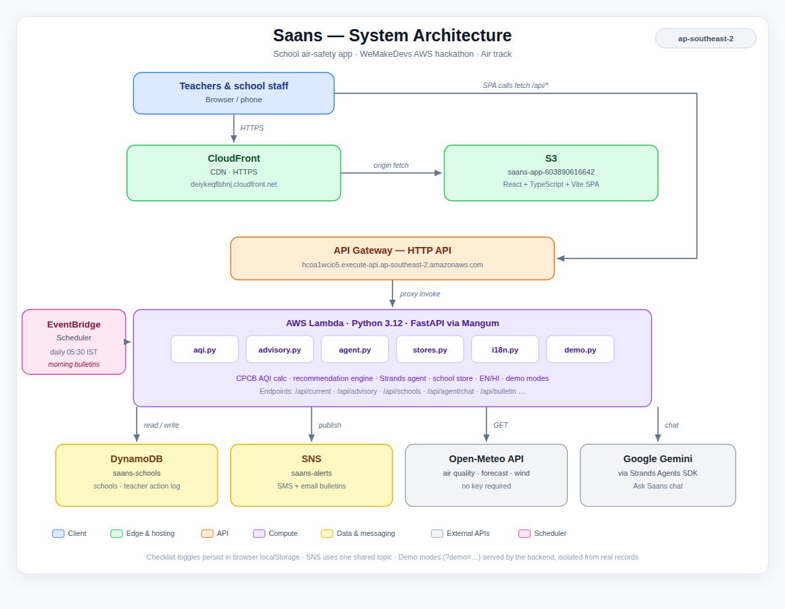

# Saans — School Air Safety 🌱

**Track: Air** · WeMakeDevs Environmental Hacks (Bharat Builds Tour, Event 02)

Every October, stubble-burning season pushes North India's AQI into the red — and
250M+ students have zero protocol for when it's unsafe to play outside.
**Saans gives every school a morning breathing bulletin**: live AQI, a 48-hour
exposure forecast, a plain-language call (normal day vs indoor day), the cleanest
outdoor windows, and an AI advisor that answers parents' questions in plain language.

## What it does (one working loop)

1. **Dashboard** — search any Indian city → live AQI gauge (CPCB India scale),
   pollutant breakdown, 48-hour forecast chart, advisory banner, best outdoor windows.
2. **Schools** — register a school → printable morning bulletin with a concrete
   checklist a principal can pin on the notice board.
3. **Ask Saans** — chat with an AI advisor grounded in live data
   ("Should my asthmatic son play football tomorrow?").
4. **Methodology** — honest data notes: what's measured vs modelled, what
   "indicative" means, and the AWS architecture.

## Quickstart (2 minutes, no keys, no AWS account)

```bash
# backend
cd backend
python -m venv .venv && source .venv/bin/activate
pip install -r requirements.txt
uvicorn app.main:app --port 8000

# frontend (new terminal)
cd frontend
npm install
npm run dev        # → http://localhost:5173 (API at :8000)
```

Open http://localhost:5173 — Patna loads by default with **live data**.
No API keys needed for the core app. For the full AI agent, add a free
Gemini key (Google AI Studio, no card): `GEMINI_API_KEY=...` in `backend/.env`
— without it, the chat transparently uses the rule-based fallback.

## Data (real, no mocks)

- **Open-Meteo Air Quality API** (free, no key): hourly PM2.5/PM10/O₃/NO₂/SO₂/CO,
  current + 3-day forecast, any coordinate on Earth.
- **AQI math**: official CPCB (India) breakpoint tables, max-sub-index rule.
  CPCB officially uses 24-hour averages; we apply breakpoints to hourly values and
  label the result **indicative** everywhere — in the API (`data_status`), and in
  the UI footnote. If Open-Meteo is unreachable the API returns 503, never fake numbers.

## Built on AWS

- **Strands Agents SDK** (AWS open source) powers the Ask Saans advisor, with
  tools (`get_current_aqi`, `get_forecast_summary`, `get_school_advisory`) calling
  our own engine. This alone satisfies the hackathon's prize-eligibility rule.
- **`infra/template.yaml`** — AWS SAM template for the serverless deploy:
  Lambda (FastAPI via Mangum) + API Gateway, EventBridge Scheduler (daily 05:30 IST
  bulletin run), DynamoDB (`saans-schools`), SNS (alerts). Free-tier friendly.
  ```bash
  cd infra && sam build && sam deploy --guided
  ```
  Frontend ships as a static site → S3 + CloudFront (HTTPS).

## Architecture (deployed stack)



**Live:** app at `https://deiykeqflshnj.cloudfront.net` · API at
`https://hcoa1wcio5.execute-api.ap-southeast-2.amazonaws.com` (region `ap-southeast-2`).

- **Edge & hosting** — CloudFront CDN serves the React + TypeScript SPA from the
  `saans-app-603890616642` S3 bucket. The browser calls the API directly (`fetch /api/*`).
- **API** — API Gateway HTTP API proxy-invokes a single Lambda.
- **Compute** — AWS Lambda (Python 3.12) runs FastAPI via Mangum. Modules:
  `aqi.py` (CPCB AQI math), `advisory.py` (recommendation engine, school-aware
  windows, wind explanations, demo modes), `agent.py` (Strands agent + rule-based
  fallback), `stores.py` (school store, teacher action log), `i18n.py` (English/Hindi).
- **Data & messaging** — DynamoDB (`saans-schools`) persists schools and the teacher
  action log; SNS (`saans-alerts`) delivers SMS/email bulletins with confirmation opt-in.
- **Scheduler** — EventBridge Scheduler fires the 5:30 AM IST bulletin run daily;
  material-change detection means families are only pinged when the advice changes.
- **External APIs** — Open-Meteo (air quality, 48h forecast, wind; no key required);
  Google Gemini via the Strands Agents SDK powers Ask Saans chat.

## Repo layout

```
saans/
├── backend/          # FastAPI: Open-Meteo client, CPCB AQI, advisory engine,
│                     # Strands agent (+ rule-based fallback), schools store
├── frontend/         # Vite + React + TS + Tailwind + Recharts (4 pages)
├── infra/            # SAM template.yaml (Lambda/API GW/EventBridge/DynamoDB/SNS)
├── docs/             # DEMO_SCRIPT.md, DEPLOY.md, ARCHITECTURE.md
└── API_CONTRACT.md   # the contract both sides implement
```

## How it maps to the judging criteria

| Criterion | How Saans answers it |
|---|---|
| Idea & Impact | One small problem solved well: schools get a daily breathing protocol. |
| Built on AWS | Strands Agents SDK (open source) + live SAM serverless deploy: Lambda, API Gateway, DynamoDB, EventBridge Scheduler, SNS. |
| Design & usability | Plain-language calls, printable bulletin, chat in simple English/Hindi. |
| Execution | One loop that runs on live data — verified endpoint by endpoint. |
| Demo video | `docs/DEMO_SCRIPT.md` — a timed 3-minute arc. |
